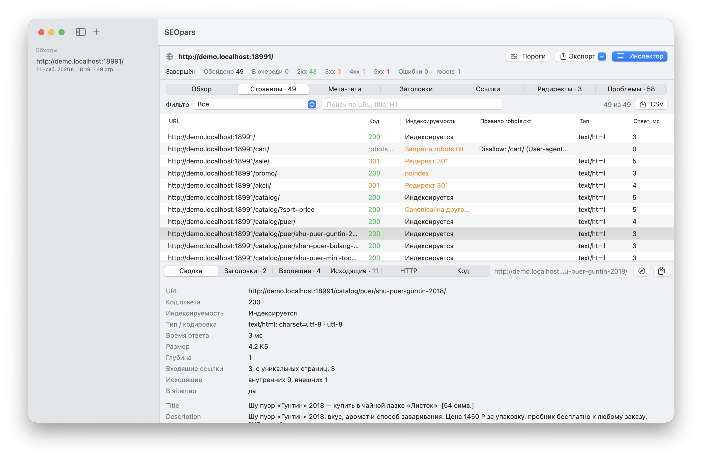
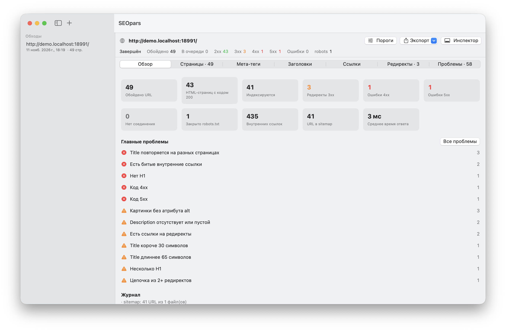
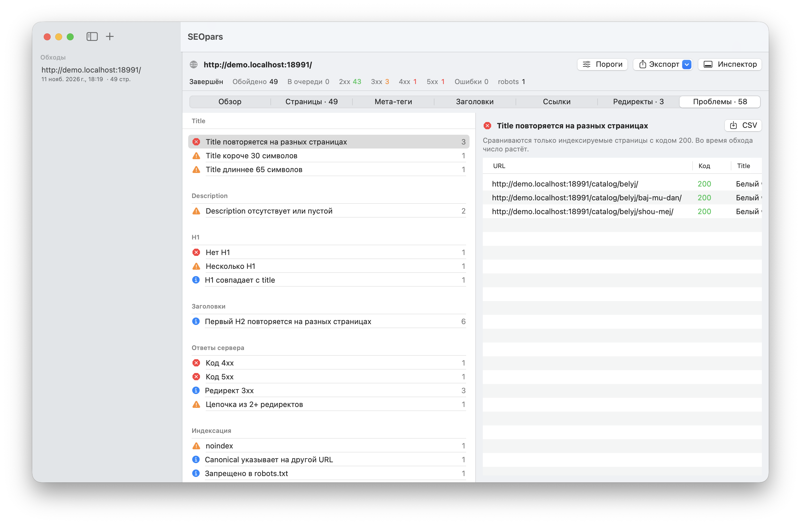
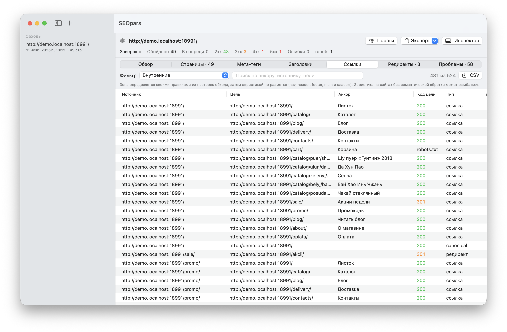

<div align="center">

# SEOpars

**SEO-парсер сайта для macOS.** Обходит сайт, собирает title, description, заголовки и внутренние ссылки, находит проблемы и выгружает всё в CSV. Таблицы наполняются прямо во время обхода.

[](#установка)
[](Package.swift)
[](Sources/SEOpars)
[](https://github.com/Peter-Grishechkin/SEOpars/releases/latest)
[](LICENSE.md)
[](https://t.me/seo_and_sem)

</div>

<p align="center">
  <picture>
    <source media="(prefers-color-scheme: dark)" srcset="docs/images/pages-dark.png">
    
  </picture>
</p>
<p align="center"><sub>Обход демо-сайта: таблица страниц и инспектор выбранной страницы. Сайт и цифры на снимках иллюстративные.</sub></p>

## Возможности

- **Обход.** Режим «паук» от стартовой страницы или список URL. Учитывает `sitemap.xml`, включая индексные, и `robots.txt` для выбранного бота, `Crawl-delay` тоже. Границы: только хост, с поддоменами или подпапка; лимиты глубины и числа страниц; фильтры URL по регулярным выражениям; потоки и пауза. User-Agent: SEOpars, Googlebot, YandexBot или свой.
- **Пауза и продолжение.** Обход хранится в одном файле SQLite и продолжается с того же места даже после перезапуска приложения.
- **Рунет.** Кириллические адреса и домены, страницы в windows-1251, отбрасывание utm и других меток, `Clean-param` Яндекса для YandexBot. Слэш на конце и регистр пути не склеиваются молча: такие адреса попадают в проблему «Дубль URL».
- **Данные страницы.** Код ответа и индексируемость (noindex, canonical, запрет в robots.txt), title, description, H1–H6, canonical, hreflang, картинки и alt, число слов, время ответа, сохранённый HTML во вкладке «Код».
- **Ссылки.** Все внутренние ссылки с анкорами и зоной (меню, шапка, подвал, контент), входящие и исходящие у каждой страницы, глубина в кликах, сироты из sitemap, редиректы и их цепочки.
- **58 проверок** в девяти группах: Title, Description, H1, заголовки, ответы сервера, индексация, hreflang, ссылки, контент. Три уровня: ошибка, предупреждение, замечание. Пороги длины title и description — рабочие ориентиры, а не нормы поисковиков, их можно поменять.
- **Экспорт в CSV.** Любая таблица с текущим фильтром, отдельно — все связи «источник → цель → анкор». UTF-8 с BOM, разделитель «;» или «,»: Excel и Numbers открывают кириллицу без настройки.
- **Командная строка.** `seopars-cli` обходит сайт и выгружает CSV без интерфейса.

## Экраны

<table>
  <tr>
    <td width="50%">
      <picture>
        <source media="(prefers-color-scheme: dark)" srcset="docs/images/overview-dark.png">
        
      </picture>
      <p align="center"><b>Обзор</b>: сводка обхода и главные проблемы</p>
    </td>
    <td width="50%">
      <picture>
        <source media="(prefers-color-scheme: dark)" srcset="docs/images/issues-dark.png">
        
      </picture>
      <p align="center"><b>Проблемы</b>: проверки по группам и страницы с выбранной</p>
    </td>
  </tr>
  <tr>
    <td width="50%">
      <picture>
        <source media="(prefers-color-scheme: dark)" srcset="docs/images/links-dark.png">
        
      </picture>
      <p align="center"><b>Ссылки</b>: источник, цель, анкор, код цели и зона</p>
    </td>
    <td width="50%">
      <picture>
        <source media="(prefers-color-scheme: dark)" srcset="docs/images/pages-dark.png">
        
      </picture>
      <p align="center"><b>Страницы</b>: код, индексируемость и инспектор страницы</p>
    </td>
  </tr>
</table>

Светлая или тёмная версия картинок подбирается по теме GitHub.

## Установка

Нужны Mac на Apple silicon и macOS 15 или новее.

1. Скачайте `SEOpars-<версия>-macos-arm64.zip` со страницы [последнего релиза](https://github.com/Peter-Grishechkin/SEOpars/releases/latest) и распакуйте. В архиве `SEOpars.app`, командная строка `seopars-cli` и текст лицензии.
2. Перетащите `SEOpars.app` в «Программы».
3. Приложение подписано ad-hoc и не заверено Apple, поэтому при первом запуске macOS откажется его открыть. После этого откройте «Системные настройки» → «Конфиденциальность и безопасность»: там появится строка «Файл „SEOpars“ заблокирован для защиты Вашего Mac» и кнопка «Все равно открыть». Если кнопки нет или macOS пишет, что приложение повреждено, снимите карантин в Терминале:

```bash
xattr -dr com.apple.quarantine /Applications/SEOpars.app
```

С `seopars-cli` из архива карантин снимается так же: `xattr -d com.apple.quarantine seopars-cli`.

## Сборка из исходников

Нужны macOS 15 или новее и Command Line Tools с Swift 6. Xcode не нужен.

```bash
./scripts/build-app.sh
```

```bash
open build/SEOpars.app
```

Приложение собирается в `build/SEOpars.app`, его можно перетащить в «Программы». Подпись ad-hoc, приложение для этого Mac.

Начать обход сразу при запуске:

```bash
open build/SEOpars.app --args --start https://example.ru/
```

## Обход из терминала

```bash
build/seopars-cli crawl https://example.ru/ --max 500 --csv ./выгрузка
```

Остальные команды: `resume <файл.seocrawl>` и `report <файл.seocrawl> --csv папка`. Ключи: `--threads`, `--delay`, `--ua seopars|googlebot|yandexbot`, `--scope host|subdomains|subfolder`, `--depth`, `--no-robots`, `--no-sitemap`, `--exclude REGEX`, `--list файл.txt`, `--out файл`.

## Где лежат данные

Обходы хранятся в `~/Library/Application Support/SEOpars/Crawls/`, один файл `.seocrawl` (SQLite) на обход. В файле: страницы, ссылки, очередь, robots.txt и сжатый HTML для вкладки «Код». Обход, поставленный на паузу или прерванный, продолжается с того же места.

## Ограничения версии 0.2

- JavaScript не выполняется: сайт читается как исходный HTML.
- Не видно, скрыт ли заголовок или текст стилями.
- Зона ссылки (меню, шапка, подвал, контент) определяется эвристикой по разметке. Свои правила «зона ← CSS-селектор» задаются в настройках обхода и применяются во время обхода: в готовом обходе зоны не пересчитываются.
- Связи hreflang записываются с 2026-11-11. В более старых обходах проверки «нет обратной ссылки», «нет ссылки на себя» и «цель не 200» не работают — нужен повторный обход.
- Сжатые sitemap `.gz` не поддерживаются.
- Во вкладке «Ссылки» показываются первые 5 000 строк под текущий фильтр: SwiftUI-таблица держит в памяти объект на каждую строку. CSV выгружает все строки.
- Сборка с SDK macOS 26.5. В SDK 27 `@State` объявлен макросом, а плагина SwiftUI-макросов в Command Line Tools нет. SDK выбирает `scripts/sdk.sh`, и если поставить Xcode, этот обход не понадобится.

Что дальше — в [ROADMAP.md](ROADMAP.md), функции и критерии готовности — в [SPEC-2026-11-09.md](SPEC-2026-11-09.md), история изменений — в [CHANGES-LOG.md](CHANGES-LOG.md).

## Разработка

### Тесты

```bash
./scripts/test.sh
```

Обычный `swift test` под Command Line Tools не находит плагин макросов Swift Testing, скрипт передаёт путь к нему сам.

Тестовый сайт для ручной проверки: `python3 -I Tests/Fixtures/fixture_server.py 18990`. На нём есть редиректы и цепочки, петля, 404/500, robots.txt, sitemap, кириллические URL, страница в windows-1251, utm, дубли по слэшу, сирота и глубокие страницы, а с 2026-11-11 — по странице на каждую проверку canonical, H1/H2, alt и hreflang (правильная пара `/hreflang/ru/` ↔ `/hreflang/en/` и пять страниц с ошибками), с 2026-11-12 — и на каждую проверку перелинковки (`/nofollow-only`, `/from-noindex`, `/dead-end`). Нагрузочный раздел `/gen/0` содержит 5 000 страниц с общим меню на 80 ссылок, всего около 425 тысяч ссылок.

Нагрузка на 2026-11-09 (локальный сервер, без паузы):
- CLI в release-сборке обходит 5 000 страниц за 3,8 с, память 116 МБ.
- Приложение проходит тот же объём примерно за 30 с при паузе 5 мс, пик памяти около 430 МБ.

### Картинки для README

Снимки в `docs/images` — окна настоящего приложения, а не макеты. Пересобрать:

```bash
./scripts/render-screenshots.sh
```

Скрипт поднимает демо-сайт `scripts/screenshots/demo_site.py` (вымышленная чайная лавка с намеренными ошибками), запускает копию SEOpars с отдельным bundle id и временной папкой данных, обходит сайт и снимает окно в светлой и тёмной теме. Ваши обходы и настройки он не видит и не меняет. Нужны разрешения «Запись экрана» и «Универсальный доступ» для терминала. Съёмка занимает 1–2 минуты, в это время окно SEOpars на переднем плане: мышь и клавиатуру не трогать.

### Устройство

- `Sources/SEOparsCore`: ядро без интерфейса.
  - Нормализация URL: `URLNormalizer.swift`.
  - robots.txt: `RobotsTxt.swift`.
  - Кодировки: `TextDecoding.swift`.
  - Разбор HTML: `HTMLAnalyzer.swift`.
  - Обходчик: `Crawler.swift`.
  - Файл обхода: `CrawlStore.swift`.
  - Проверки: `Analysis.swift`.
  - Строки таблиц и CSV: `Rows.swift`.
  - Модель живого обновления: `CrawlSession.swift`.
- `Sources/SEOpars`: интерфейс на SwiftUI.
- `Sources/seopars-cli`: обход без интерфейса.

## Лицензия

[PolyForm Noncommercial 1.0.0](LICENSE.md). Автор — Peter Grishechkin. Лицензия распространяется на весь репозиторий: код и документацию.

Коротко:
- Можно использовать, изучать, менять и распространять в некоммерческих целях: для себя, в учёбе и исследованиях, в некоммерческих и государственных организациях.
- Коммерческое использование лицензия не разрешает, например платные аудиты сайтов клиентов. Оно возможно по отдельной договорённости с автором.
- Указание автора обязательно: кто передаёт копию программы или её части, в том числе изменённую, передаёт вместе с ней текст лицензии и строку `Required Notice` с именем автора из начала `LICENSE.md`.

Юридическую силу имеет английский текст в `LICENSE.md`, этот пересказ — для удобства.

## Автор

Пётр Гришечкин, SEO-специалист. О SEO, AI и своих инструментах, включая SEOpars, пишу в Telegram-канале [«Разум Петра (SEO, AI и около)»](https://t.me/seo_and_sem). Контакты для вопросов и договорённостей о коммерческом использовании — в закрепе канала. В приложении канал открывается из меню «Справка».
